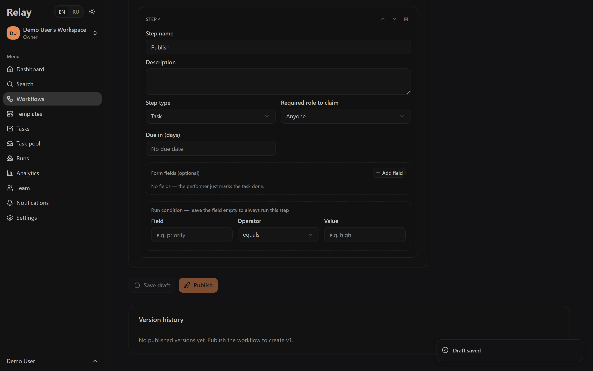
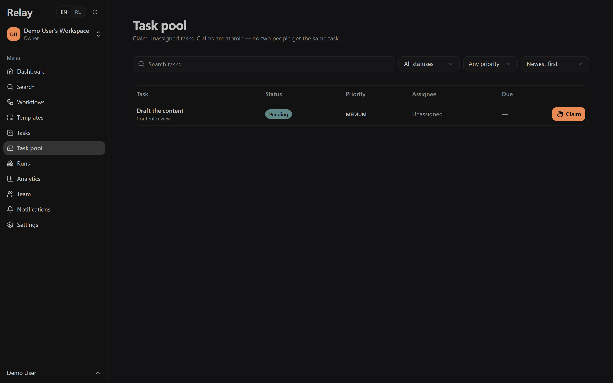
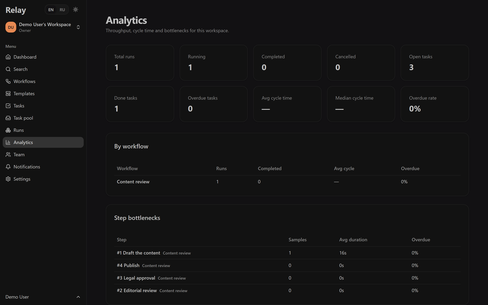
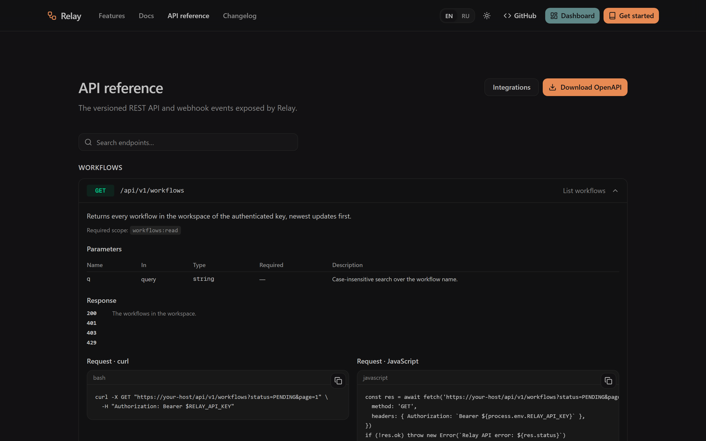
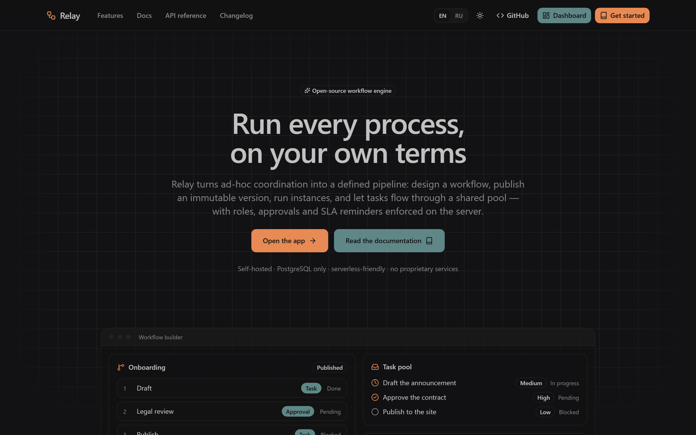
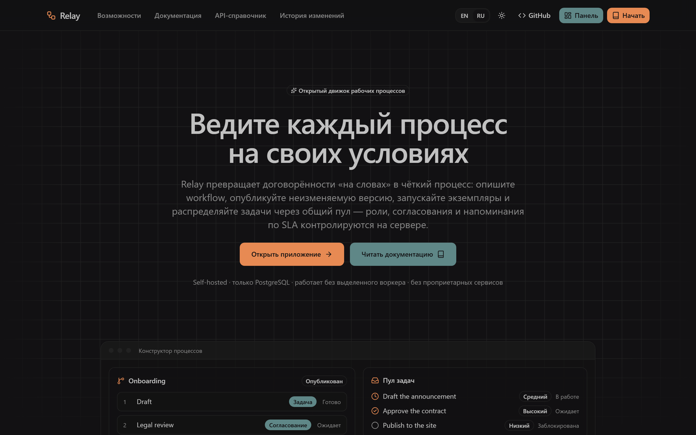

<div align="center">
  
</div>

<h1 align="center">Relay</h1>

<p align="center">
  <b>The open-source workflow engine for teams that run on process.</b><br />
  Design a workflow, publish an immutable version, run instances and move tasks
  through a shared pool — with roles, approvals, SLA reminders, a REST API and
  signed webhooks. Self-hosted on your own PostgreSQL.
</p>

<p align="center">
  <a href="https://github.com/kollakek1/Relay/actions/workflows/ci.yml">
    
  </a>
  <a href="https://github.com/kollakek1/Relay/releases">
    
  </a>
  <a href="LICENSE">
    
  </a>
  
  <a href="CONTRIBUTING.md">
    
  </a>
</p>

---

## Table of contents

- [What Relay is](#what-relay-is)
- [Features](#features)
- [Screenshots](#screenshots)
- [Architecture](#architecture)
- [Tech stack](#tech-stack)
- [Quickstart](#quickstart)
- [Local development](#local-development)
- [Self-hosting and configuration](#self-hosting-and-configuration)
- [Project structure](#project-structure)
- [Documentation](#documentation)
- [Public API](#public-api)
- [Testing](#testing)
- [Contributing](#contributing)
- [Security](#security)
- [License](#license)
- [Project status and known limitations](#project-status-and-known-limitations)

## What Relay is

Relay is a **self-hosted workflow engine**. You describe a process as an ordered
set of steps; Relay turns each run into real tasks with owners, due dates,
approvals and an audit trail. It is deliberately small in surface area and strict
about correctness: authorization, tenant isolation and concurrency are enforced
in the database and the server layer, not in the browser.

Typical uses: onboarding and offboarding, content and contract review,
request/approval pipelines, and any internal process where work must move through
defined steps without a spreadsheet for a database.

## Features

| | |
| --- | --- |
| **Workflow design** | Ordered steps, each a task or an approval. Per-step form fields, required role, due-in-days, and skip conditions based on values collected earlier. |
| **Publishing and versions** | Publishing freezes an immutable snapshot. Running instances never change when you keep editing the draft; you can diff and restore versions. |
| **Shared task pool** | Unassigned work is claimed with a single atomic update — two people can never hold the same task. |
| **Approvals** | `ANY` (first decision wins) and `ALL` (every eligible approver decides) modes, with approve / request-changes / reject and a decision log. |
| **Organizations and roles** | `OWNER > ADMIN > MEMBER`, enforced server-side on every mutation. Multiple workspaces, ownership transfer, admin audit log. |
| **Invitations** | Invite by email with hashed, single-use, expiring links. Atomic acceptance. |
| **Collaboration** | Comments, watchers, tags, task dependencies, reopening, and an append-only activity trail. |
| **Notifications** | Assignment, comments, approvals, invitations and SLA reminders, with an unread count. |
| **Automation rules** | React to domain events: `notify_role`, `add_tag`, `set_priority`, `create_task`. Idempotent per rule and event. |
| **Reliable eventing** | A transactional outbox fans events out to HMAC-signed webhooks with retries, leases, a dead-letter state and admin requeue. |
| **Public API** | Scoped, hashed API keys against `/api/v1`, with pagination, uniform errors and per-key rate limits. |
| **Analytics** | Throughput, completion and overdue rates, cycle time and step bottlenecks — isolated per workflow. |
| **Search and export** | Tenant-scoped global search, and bounded CSV export that neutralises spreadsheet formula injection. |
| **English and Русский** | A typed dictionary i18n system with a remembered preference across the site, the app and the docs. |
| **Hardened** | Database-backed rate limiting, structured redacting logs, an audit trail, an SSRF guard for outbound requests, and no default credentials. |

## Screenshots

<!-- The screenshots below are captured from a local instance with the seeded
     demo workspace (`docs/assets/screens/`). Regenerate with
     `npm run screenshots`. -->

| Workflow builder | Task pool |
| --- | --- |
|  |  |

| Analytics | API reference |
| --- | --- |
|  |  |

| Landing page (English) | Landing page (Russian) |
| --- | --- |
|  |  |

## Architecture

Relay is a single Next.js application backed by one PostgreSQL database, with no
long-running worker.

```
Browser  ──▶  Next.js (App Router)  ──▶  Service layer (authz + tenant scope)  ──▶  PostgreSQL
                     │                                                                    ▲
                     ├─ Server Actions / Route Handlers                                    │
                     │                                                                    │
                     └─ POST /api/jobs/*  ──▶  Transactional outbox ──▶  Webhooks ────────┘
                          (cron-triggered,     (events written with the
                           bounded, idempotent) mutation, claimed with a lease)
```

- **Layers** — `app/` (routes) → `features/<domain>/{schemas,server,actions,components}`.
  Only `features/<domain>/server` talks to Prisma, and every query is scoped by
  `organizationId`.
- **Authorization** — the active workspace is read from a cookie but always
  re-validated against a real membership. Roles are re-derived from the database
  on every request; a foreign identifier resolves to *not found*, never to
  another tenant's data.
- **Execution** — publishing freezes a version; instances reference it; tasks are
  released step by step and claimed atomically.
- **Background work** — domain events are written to a transactional outbox in
  the same transaction as the mutation. A bounded, secret-protected job claims
  work with `SELECT … FOR UPDATE SKIP LOCKED` plus a lease, retries with backoff,
  and dead-letters what is exhausted. Delivery is **at-least-once**.

Details: [`docs/ARCHITECTURE.md`](docs/ARCHITECTURE.md).

## Tech stack

- **Framework:** Next.js 16 (App Router, Server Actions), React 19
- **Language:** TypeScript (strict)
- **Database:** PostgreSQL 14+ with Prisma 7 (`@prisma/adapter-pg`)
- **Auth:** Better Auth (email + password)
- **UI:** Tailwind CSS v4, shadcn/ui, Lucide
- **Validation:** Zod · **Tests:** Vitest 5, Playwright

## Quickstart

Requirements: **Node.js 20+** and **PostgreSQL 14+**. Nothing else is mandatory —
email, cron and outbound webhooks degrade gracefully when unconfigured.

```bash
git clone https://github.com/kollakek1/Relay
cd Relay
npm install                # also generates the Prisma client

cp .env.example .env       # set DATABASE_URL and BETTER_AUTH_SECRET

npm run db:deploy          # apply migrations
ROOT_EMAIL=you@example.com ROOT_PASSWORD='a-strong-unique-password' npm run db:seed
npm run dev                # http://localhost:3000
```

Then sign in and: create a workflow → add steps → **Publish** → **Start
instance** → claim the task from the **Task pool** → complete it.

The seed refuses a missing, short or placeholder password and never prints it.
Set `SEED_DEMO_DATA=true` to also create a small demo workspace.

Full walkthrough: [`docs/guides/QUICKSTART.md`](docs/guides/QUICKSTART.md).

## Local development

```bash
npm run dev          # dev server
npm run lint         # ESLint
npm run typecheck    # tsc --noEmit
npm test             # Vitest (needs DATABASE_URL)
npm run test:e2e     # Playwright smoke test (E2E=1, needs a DB + server)
npm run db:generate  # regenerate the Prisma client
npm run db:migrate   # create + apply a migration
npm run db:validate  # validate the Prisma schema
npm run api:check    # OpenAPI spec matches the implemented routes
npm run i18n:check   # RU/EN translation completeness
```

The generated Prisma client is **not** committed; `npm install` and
`npm run build` generate it from `prisma/schema`. Integration tests create and
delete their own rows — point them at a dedicated test database, never at data
you care about.

## Self-hosting and configuration

Production:

```bash
npm ci
npx prisma migrate deploy   # never `db push`, never reset
npm run build
npm run start
```

Required environment:

| Variable | Required | Purpose |
| --- | --- | --- |
| `DATABASE_URL` | yes | PostgreSQL connection string. |
| `BASE_URL` | yes | Public origin (auth and invitation links). |
| `BETTER_AUTH_SECRET` | production | Session signing secret (`openssl rand -base64 32`). |
| `CRON_SECRET` | recommended | Bearer secret for `/api/jobs/*`; without it the jobs return `503`. |
| `RESEND_API_KEY` / `EMAIL_FROM` | optional | Send invitation emails. |
| `ROOT_EMAIL` / `ROOT_PASSWORD` | seed only | Bootstrap the first administrator. |
| `SEED_DEMO_DATA` | optional | Create a demo workspace. |
| `OUTBOUND_ALLOWED_PORTS` | optional | Ports allowed for webhook delivery. |

Scheduled work (there is no worker):

```bash
curl -X POST https://your-host/api/jobs/drain    -H "Authorization: Bearer $CRON_SECRET"  # every minute
curl -X POST https://your-host/api/jobs/sla-scan -H "Authorization: Bearer $CRON_SECRET"  # every hour
```

The secret is accepted **only** in the `Authorization` header and only over
`POST`; it is never taken from the query string.

See [`docs/guides/CONFIGURATION.md`](docs/guides/CONFIGURATION.md) and
[`docs/guides/DEPLOYMENT.md`](docs/guides/DEPLOYMENT.md) (includes HTTPS,
backups, upgrades and serverless notes).

## Project structure

```
app/                      routes (public site, dashboard, /api)
  (main)/                 public marketing site, docs and API reference
  dashboard/              authenticated application
  api/                    auth, export, jobs, /api/v1, /api/openapi
features/<domain>/        schemas · server services · actions · components
shared/
  components/ui/          shadcn primitives
  components/site/        public-site components
  i18n/                   typed translations, locale resolution, formatting
  server/                 authorization, errors, logging, rate limiting, retry, SSRF
prisma/                   schema fragments, migrations, seed
tests/                    Vitest unit + integration suites
e2e/                      Playwright smoke test
docs/                     guides, architecture, security, API spec
```

## Documentation

- **Quickstart** — [`docs/guides/QUICKSTART.md`](docs/guides/QUICKSTART.md)
- **Deployment** — [`docs/guides/DEPLOYMENT.md`](docs/guides/DEPLOYMENT.md)
- **Configuration** — [`docs/guides/CONFIGURATION.md`](docs/guides/CONFIGURATION.md)
- **Workflows** — [`docs/guides/WORKFLOWS.md`](docs/guides/WORKFLOWS.md)
- **Automations and jobs** — [`docs/guides/AUTOMATIONS.md`](docs/guides/AUTOMATIONS.md)
- **Integrations (API & webhooks)** — [`docs/guides/INTEGRATIONS.md`](docs/guides/INTEGRATIONS.md)
- **Architecture** — [`docs/ARCHITECTURE.md`](docs/ARCHITECTURE.md)
- **Security model** — [`docs/SECURITY.md`](docs/SECURITY.md) · [Threat model](docs/THREAT_MODEL.md)
- **Testing** — [`docs/TESTING.md`](docs/TESTING.md) · **Incident response** — [`docs/INCIDENT_RESPONSE.md`](docs/INCIDENT_RESPONSE.md)
- **Known limitations** — [`docs/KNOWN_LIMITATIONS.md`](docs/KNOWN_LIMITATIONS.md)
- **Changelog** — [`CHANGELOG.md`](CHANGELOG.md)

The same guides (in English and Russian) are served by the app at `/docs`, with
an interactive reference at `/api-reference`.

## Public API

A versioned JSON API under `/api/v1`, authenticated with a scoped API key
(`Authorization: Bearer rk_…`). Keys are stored only as SHA-256 hashes and act
with the current role of the account that created them.

| Method | Path | Scope |
| --- | --- | --- |
| `GET` | `/api/v1/workflows` | `workflows:read` |
| `POST` | `/api/v1/workflows/{id}/run` | `instances:write` |
| `GET` | `/api/v1/instances` | `instances:read` |
| `GET` | `/api/v1/tasks` | `tasks:read` |
| `GET` | `/api/v1/tasks/{id}` | `tasks:read` |
| `POST` | `/api/v1/tasks/{id}/claim` | `tasks:write` |

The OpenAPI 3.1 document is served at **`/api/openapi`** (source:
[`docs/api/openapi.json`](docs/api/openapi.json)) and is validated against the
route files in CI, so it cannot drift. A CI check fails if a documented path has
no handler or an implemented route is undocumented.

## Testing

```bash
npm test                          # unit + integration (23 files)
E2E=1 npm run test:e2e            # browser smoke test (needs a DB + server)
```

Coverage includes authorization and tenant isolation, the state machine, atomic
claims under concurrency, invitation single-use, rate limiting, CSV injection,
SSRF classification and DNS rebinding, outbox leases/retries/dead-letter,
automation idempotency, analytics isolation, and the seed's credential policy.
CI runs lint, types, Prisma validation and migrations, the full test suite, the
OpenAPI and i18n checks, a production build, and the Playwright smoke test.

## Contributing

Contributions are welcome — see [`CONTRIBUTING.md`](CONTRIBUTING.md) for setup,
the checks you must run, and the conventions. Please read the
[Code of Conduct](CODE_OF_CONDUCT.md) first.

## Security

Do not open a public issue for a security problem. See
[`SECURITY.md`](SECURITY.md) for private reporting and scope. The controls that
exist today, and the residual risks Relay explicitly accepts, are documented in
[`docs/SECURITY.md`](docs/SECURITY.md) and
[`docs/THREAT_MODEL.md`](docs/THREAT_MODEL.md).

## License

Copyright © 2026 kollakek1

Relay is free software: you can redistribute it and/or modify it under the terms
of the **GNU Affero General Public License**, version 3, as published by the Free
Software Foundation.

Relay is distributed in the hope that it will be useful, but **WITHOUT ANY
WARRANTY**; without even the implied warranty of MERCHANTABILITY or FITNESS FOR A
PARTICULAR PURPOSE. See the [full AGPL v3 text](LICENSE) for the exact terms.

> Because the AGPL is a network-copyleft license, anyone who runs a modified
> Relay as a network service must offer the corresponding source to their users.

## Project status and known limitations

Relay is **pre-1.0**: the workflow engine, API and i18n are complete and tested,
but the database schema and the public API may still change between minor
releases. There is no hosted offering — you run your own instance.

Read [`docs/KNOWN_LIMITATIONS.md`](docs/KNOWN_LIMITATIONS.md) before deploying.
Highlights: delivery is at-least-once (deduplicate on `x-relay-delivery`); a
residual DNS-rebinding TOCTOU window remains in the SSRF guard; rate limiting is
fixed-window; email verification is disabled; workflow execution is linear (no
parallel branches or BPMN gateways); and some deeper dashboard panels are
English-only.

<div align="center">
  <sub>Built with Next.js, PostgreSQL, Prisma and Better Auth.</sub>
</div>
